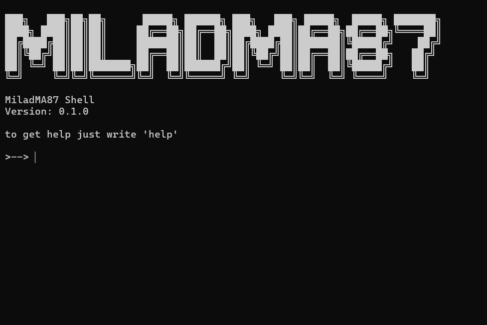

# MiladMA87 Shell

A small, dependency-free terminal written in pure Python. It has the everyday file and network commands you would expect, plus a **remote mode** that lets you control your other machines on the same LAN (for example a personal home server) from one prompt.

> **Educational project.** The remote mode is built for a trusted home network. See [Security](#security) before using it.




## Features

- File and folder commands: `ls`, `cd`, `mkdir`, `cp`, `rm`, `tree`, `find` and more
- Network tools: `ping`, `ipconfig`, `tracert`, `nslookup`, `netstat`, `download`
- Quoted arguments work (`cd "My Folder"`)
- A bug in one command never crashes the terminal
- **Remote mode:** discover machines on your LAN and run commands on them
- No third-party packages, only the Python standard library

## Requirements

- Python 3.8 or newer
- Tested on Windows and Linux.

## Getting started

**1. Check that Python is installed**

```
python --version
```

On Linux and macOS the command is usually `python3 --version`. If Python is missing, download it from [python.org](https://www.python.org/downloads/).

**2. Clone the project**

```
git clone https://github.com/MiladMA87/Mshell.git
cd Mshell
```

No Git? On the [repository page](https://github.com/MiladMA87/Mshell) click **Code → Download ZIP**, extract it, and open a terminal inside the extracted folder.

**3. Run it**

```
python Terminal.py
```

On Linux and macOS use `python3 Terminal.py`.

There is nothing to install: the project only uses the Python standard library. Type `help` to list all commands and `exit` to quit.

> To use remote mode, clone the project on **every** machine involved (the one you control from and the ones you want to control).

## Commands

| Command | Description |
|---|---|
| `ls [dir]` | List directory contents |
| `cd <path>` | Change current directory |
| `cwd` | Show current directory |
| `mkdir <name>` | Create a directory |
| `mvdir <src> <dst>` | Move a file or folder |
| `rename <old> <new>` | Rename a file or folder |
| `rm <file>` | Remove a file |
| `rmdir <dir>` | Remove an empty directory |
| `cp <src> <dst>` | Copy a file or directory |
| `touch <file>` | Create an empty file |
| `cat <file>` | Print a text file |
| `find <name> [dir]` | Search files and directories |
| `tree [dir]` | Show a directory tree |
| `ping [host]` | Check network connectivity |
| `web <url>` | Open a website in the browser |
| `ipconfig` | Show network configuration |
| `tracert <host>` | Trace the network route |
| `nslookup <host>` | DNS lookup |
| `netstat` | Show network connections |
| `hostname` | Show the computer name |
| `download <url> [file]` | Download a file |
| `exec` | Remote mode: control other PCs on your LAN |
| `listen` | Let other PCs on your LAN control this one |
| `clear` | Clear the terminal |
| `help` / `exit` | Show help / quit |

## Remote mode

Remote mode has two sides.

**On the machine you want to control** (the receiver, e.g. your server):

```
>--> listen
Set a password for this receiver: ********
```

The receiver waits for connections and prints every command it runs. Press `Ctrl+C` to stop it.

**On the machine you control from:**

```
>--> exec
exec> connect
  1) home-server      192.168.1.20     Linux
  2) laptop           192.168.1.31     Windows
Enter a number: 1
Password for home-server: ********
[home-server /home/me >--> ls
```

Everything you type now runs on the receiver, and its output is sent back. The prompt shows the receiver's current directory.

- `disconnect` (or `exit`) closes the connection and returns to `exec>`
- `exit` inside `exec>` returns to the normal terminal
- `connect <ip>` connects directly when automatic discovery does not work (for example on Wi-Fi with client isolation)
- For headless servers, set the environment variable `MILAD_REMOTE_PASSWORD` instead of typing the password

Ports used: **UDP 50505** (discovery) and **TCP 50506** (session). On Windows, allow Python through the firewall on *Private* networks the first time you run `listen`.

### How it works

1. The client broadcasts a discovery message on the LAN. Receivers answer with their name and port.
2. The client connects over TCP and proves it knows the password with an HMAC challenge-response. The password is never sent.
3. Each message after that carries an HMAC and a counter, so commands cannot be injected or replayed.
4. The receiver runs the command through the same dispatcher as the local terminal, captures its output, and sends it back.

## Security

This is a hobby project. Read this before using remote mode:

- **Traffic is not encrypted.** Someone who can sniff your network could read command output. They cannot send commands without the password, but do not run this on untrusted networks.
- Only private/LAN addresses are accepted. After 5 wrong passwords an address is locked out for 60 seconds.
- Use a long passphrase. A short or common password can be guessed offline from a captured handshake.
- **Never expose the receiver's port to the internet.**
- The receiver runs in the foreground only when you start it, and logs every command it executes.
- For anything serious, use SSH instead.

## Project structure

```
Terminal.py        main loop
Commands.py        command table (name -> function + description)
Dispatcher.py      runs one command line (used locally and by the receiver)
UI.py              banner and screen redraw
System/
    Kernel.py      file and directory commands
Internet/
    Web.py         network commands
    Remote.py      remote mode (discovery, authentication, receiver, client)
```

## Adding a command

1. Write a function that takes one argument, a list of strings (the arguments the user typed):

   ```python
   def hello(path=None):
       print("Hello", path[0] if path else "world")
       return True
   ```

2. Register it in `Commands.py`:

   ```python
   "hello": {"function": hello, "description": "Say hello"},
   ```

`help` picks it up automatically, and it also works through remote mode.

## Roadmap

- [ ] TLS encryption for remote mode (standard-library `ssl`)
- [ ] File transfer between machines
- [ ] Config file for saved machines
- [ ] Automated tests
- [ ] Command history with the arrow keys

## License

MIT License. See the [LICENSE](LICENSE) file.